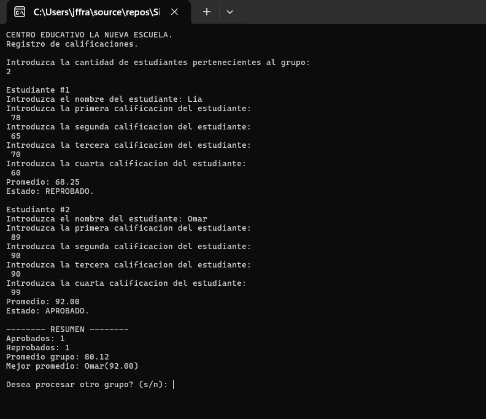
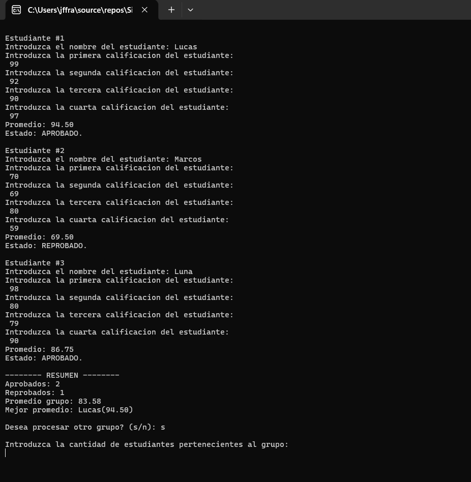
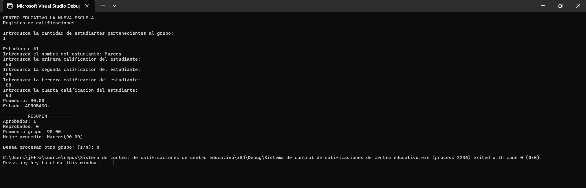
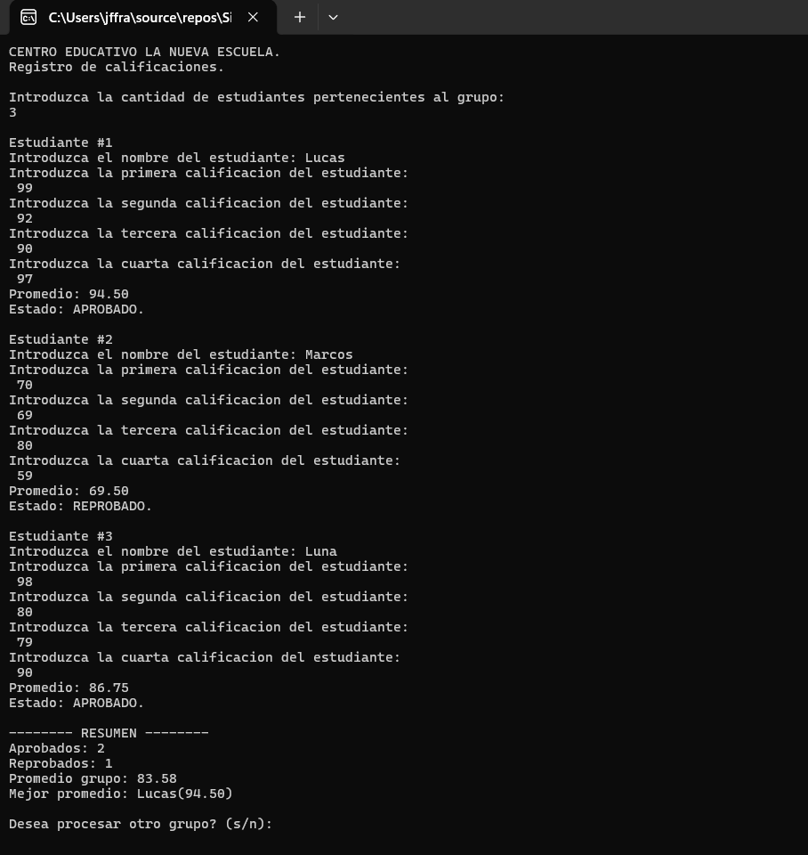
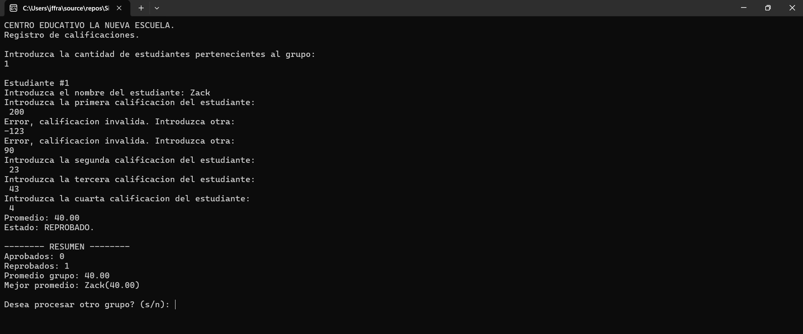

# Programa: Sistema de control de calificaciones de un centro educativo

## 1. Datos del estudiante

- **Nombre completo:** Jordany Florentino Franco
- **Matrícula:** 2025-2608

## 2. Descripción breve del programa

Este programa en C++ permite registrar y gestionar las calificaciones de un grupo de estudiantes del Centro Educativo La Nueva Escuela. Solicita la cantidad de estudiantes, sus nombres y cuatro calificaciones individuales, valida que cada nota se encuentre entre 0 y 100 y calcula el promedio correspondiente. Finalmente, determina si cada estudiante está aprobado o reprobado y muestra un resumen general con la cantidad de aprobados y reprobados, el promedio del grupo y el estudiante con el promedio más alto. También permite procesar otro grupo sin necesidad de ejecutar nuevamente el programa.

## 3. Datos de entrada

- **Cantidad de estudiantes:** Número entero que representa la cantidad de estudiantes que se registrarán en el grupo. Debe ser mayor que cero.
- **Nombre del estudiante:** Nombre correspondiente a cada estudiante registrado.
- **Primera calificación:** Primera nota del estudiante, con un valor entre 0 y 100.
- **Segunda calificación:** Segunda nota del estudiante, con un valor entre 0 y 100.
- **Tercera calificación:** Tercera nota del estudiante, con un valor entre 0 y 100.
- **Cuarta calificación:** Cuarta nota del estudiante, con un valor entre 0 y 100.
- **Respuesta para procesar otro grupo:** Carácter que permite indicar si se desea registrar otro grupo (s/n).

## 4. Datos que procesa

- Solicita la cantidad de estudiantes y comprueba que sea mayor que cero.
- Recorre cada estudiante utilizando un bucle `for` para solicitar su nombre y sus cuatro calificaciones.
- Valida cada calificación mediante estructuras `while`, asegurándose de que se encuentre dentro del rango permitido de 0 a 100.
- Suma las cuatro calificaciones de cada estudiante y divide el resultado entre cuatro para obtener su promedio individual.
- Comprueba si el promedio es mayor o igual a 70 para determinar si el estudiante está aprobado o reprobado.
- Utiliza contadores para registrar la cantidad de estudiantes aprobados y reprobados.
- Acumula los promedios individuales para calcular el promedio general del grupo.
- Compara los promedios individuales para identificar al estudiante con el promedio más alto.
- Pregunta si se desea procesar otro grupo y repite el procedimiento cuando la respuesta es afirmativa.

## 5. Datos de salida

- **Promedio individual:** Muestra el promedio obtenido por cada estudiante, con dos cifras decimales.
- **Estado académico:** Indica si cada estudiante está aprobado o reprobado, considerando 70 puntos como nota mínima para aprobar.
- **Cantidad de aprobados:** Muestra el total de estudiantes que obtuvieron un promedio igual o superior a 70.
- **Cantidad de reprobados:** Muestra el total de estudiantes que obtuvieron un promedio inferior a 70.
- **Promedio general del grupo:** Muestra el promedio de los resultados individuales de todos los estudiantes.
- **Mejor promedio:** Muestra el nombre del estudiante que obtuvo el promedio más alto y el valor correspondiente.

## Capturas del programa en ejecución

### Prueba 1: Registro de estudiantes y cálculo de promedios

### Prueba 2: Repetición del programa mediante el bucle do while.

### Prueba 3: Finalización del programa mediante la opción n.

### Prueba 4: Procesamiento de otro grupo.

### Prueba 5: Validación de calificaciones.

## 6. Estructuras utilizadas y su función

- **Variables de tipo `int`:** Se utilizan para almacenar la cantidad de estudiantes y los contadores de aprobados y reprobados.
- **Variables de tipo `float`:** Se utilizan para almacenar las cuatro calificaciones, los promedios individuales, la suma de las notas y los resultados generales del grupo.
- **Variables de tipo `string`:** Permiten almacenar los nombres de los estudiantes y el nombre del estudiante con el promedio más alto.
- **Variable de tipo `char`:** Se utiliza para almacenar la respuesta del usuario al preguntar si desea procesar otro grupo.
- **Estructura repetitiva `while`:** Permite validar la cantidad de estudiantes y las calificaciones, repitiendo la solicitud cuando se introduce un valor fuera del rango permitido.
- **Estructura repetitiva `for`:** Permite recorrer la cantidad de estudiantes indicada y ejecutar el proceso de registro, validación y cálculo de cada uno.
- **Estructura repetitiva `do while`:** Permite repetir el programa completo cuando el usuario desea procesar otro grupo.
- **Estructura condicional `if`, `else`:** Permite determinar si un estudiante está aprobado o reprobado y comparar los promedios para identificar al estudiante con la calificación más alta.
- **Librería `iostream`:** Se utiliza para solicitar información mediante `cin` y mostrar los resultados mediante `cout`.
- **Librería `iomanip`:** Se utiliza junto con `fixed` y `setprecision(2)` para mostrar los resultados con dos cifras decimales.
- **Librería `string`:** Permite trabajar con cadenas de caracteres, principalmente para almacenar los nombres de los estudiantes.
